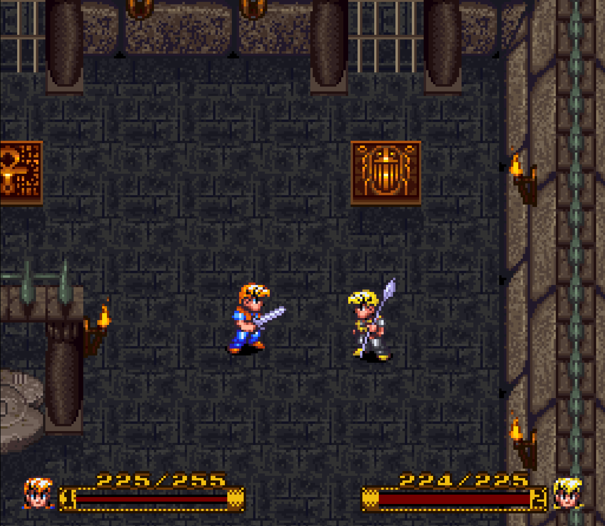

# SoE_A-second-hero-instead-of-the-dog (beta 1)

> **Requirements:** The SoE_A-second-hero-instead-of-the-dog patch is **not a standalone patch**. It requires a
> **clean, unheadered U.S. ROM of Secret of Evermore** with the official
> **[Casual Run 2.0](https://github.com/andrewclunn/Secret-of-Evermore-Casual-Run) patch** applied first.
> See [Installing](#installing).



In Casual Run's two-player mode, player 2 controls the Dog. The SoE_A-second-hero-instead-of-the-dog patch lets player 2 play **a second hero** instead: a boy with his own colors who fights with the Boy's weapon mechanics, has his own weapon choice, and can open the Weapon, Alchemy, and Item Rings himself. The second hero takes the Dog's place, so the party stays at two characters.

Without a second player, the game plays like Casual Run 2.0.

[Download the IPS patch](SoE_A-second-hero-instead-of-the-dog_beta1.ips) · [ASM sources](Build/)

## Status

**Beta 1.** The whole game has not been played through in co-op yet. Feedback and bug reports are welcome
(see [Known limitations](#known-limitations)).

## Joining and leaving

Connect two controllers. Press **Start on controller 2** at any time during play to join; player 2 appears as the second hero in the Dog's place. Press **Start on controller 2** again to leave, and the AI-controlled Dog returns.

## Controls for player 2

| Button | Action |
|---|---|
| **D-pad** | Move |
| **A** | Attack, talk, open gourds and chests, confirm |
| **B** | Walk and charge faster while held; cancel in menus |
| **L / R** | Previous / next weapon (shown as "P2: *weapon*") |
| **X** | Open player 2's Rings: Weapons, Alchemy, Items (switch with up/down) |
| **Y** | Switch between the second hero and the Dog ("P2: Dog") |
| **Select** | Switch camera focus (as in Casual Run) |
| **Start** | Join or leave |

Player 1's controls are unchanged.

## How the second hero works

- **Weapons.** Player 2 can use every weapon the party owns, independently of the Boy. The choice starts with the Boy's weapon and is saved with each save slot. Attack power is the Boy's base attack plus the power of player 2's weapon, so both heroes hit equally hard with the same weapon. The charge level follows the weapon's level, which both heroes share.
- **Weapon experience.** Kills by the second hero train the weapon he is holding.
- **Rings.** Player 2's Weapon Ring shows his own weapon and compares new weapons against it. Alchemy and items work as for the Boy, including target selection. Ingredients, items, and Bazooka ammunition are shared.
- **Gourds and chests.** The second hero can open them, and the contents go to the shared inventory.
- **Towns and interiors.** The second hero is unarmed there, like the Boy.
- **Stats.** HP, defense, evasion, level, and character experience are the Dog's. The Dog's equipment counts for the second hero.
- **Dog-only sections.** When the game marks the Boy as absent, player 2 automatically controls the Dog, and the hero returns afterwards. This has not yet been checked at every such place in the game. Use **Y** whenever you need the Dog, for example to sniff for ingredients.

## Balance

While player 2 is in the game, enemies and bosses take only 2/3 of the damage, so they effectively have **150 % of their HP**. Damage numbers still show the full value. This applies from the first hit after player 2 joins and ends when player 2 leaves.

## Known limitations

This is a beta. Please report anything unusual, ideally with the location, what both players were doing, and a screenshot.

- NPCs talk to the second hero as if he were the Dog ("pup"), because he occupies the Dog's place.
- Cutscenes involving the Dog have not been tested in hero mode. If something gets stuck, switch to the Dog with **Y**.
- Bazooka ammunition type is shared: if player 1 selects different ammunition, player 2 fires that too.

## Installing

The add-on patch contains **only the SoE_A-second-hero-instead-of-the-dog changes**. Casual Run itself is not included; please get it from the [official Casual Run repository](https://github.com/andrewclunn/Secret-of-Evermore-Casual-Run).

1. Start with a **clean, unheadered U.S. ROM of Secret of Evermore** (3,145,728 bytes, CRC32 `A5C0045E`).
2. Apply the official **Casual Run 2.0** patch (`Secret_of_Evermore_Casual_Run_v2.0.ips`) from the Casual Run repository. The add-on is made for 2.0; Casual Run 2.1 has not been tested with it.
3. Apply the add-on patch [SoE_A-second-hero-instead-of-the-dog_beta1.ips](SoE_A-second-hero-instead-of-the-dog_beta1.ips) to that Casual Run 2.0 ROM.
4. Open the patched ROM in your SNES emulator and connect two controllers.

The result is 4,194,304 bytes with CRC32 `A2E016C9` and SHA-256 `90e71b9ce36001b22172dc5cd897b7d6b182559d0d96d92b63e829fdd2ffb00d`.

**Note on the Casual Run 2.0 ROM.** Depending on the patcher, the official 2.0 IPS produces one of two ROMs that differ only in length:

| Casual Run 2.0 ROM | Size | CRC32 |
|---|---:|---|
| Complete (as documented in the Casual Run README) | 4,194,304 bytes | `691948F5` |
| Without the zero-filled last 800 bytes (e.g. Floating IPS) | 4,193,504 bytes | `38A22B85` |

The add-on patch works with both and fills in the missing bytes, so both lead to the same final ROM.

Save files from Casual Run 2.0 can be loaded. The add-on keeps its own data, such as player 2's weapon per slot, in otherwise unused save memory behind the four slots.

## Changes compared with Casual Run 2.0

- Player 2 plays a second hero in the Dog's place (described above).
- Enemies have 150 % of their HP while player 2 is in the game.
- Fix: controller 2 was ignored in 2.0 because the two-player code's ROM title check no longer matched.
- Fix: player 2's Ring input comes from controller 2 instead of controller 1.

## Building from source

The add-on is written as [asar](https://github.com/RPGHacker/asar) patches in [Build/](Build/): `fix_p2_signature.asm`, `fix_ring_pad.asm`, and `coop_hero.asm`. The script applies them to a Casual Run 2.0 ROM (either variant above) and creates the ROM and the add-on patch:

```bash
python3 Build/make_addon.py "PATH_TO_CASUAL_RUN_2.0_ROM" OUTPUT_FOLDER --asar PATH_TO_ASAR_1.91
```

Requirements: Python 3 and asar 1.91. Technical notes are in [Build/README.md](Build/README.md).

## Credits

**Built on**

- **[Casual Run](https://github.com/andrewclunn/Secret-of-Evermore-Casual-Run)** by andrewclunn and the Casual Run project: the quality-of-life patch this patch requires and builds on.
- **FuSoYa**: the two-player code (2 Players Edition) that Casual Run includes and that makes a second player possible at all.
- Everyone credited in the [Casual Run README](https://github.com/andrewclunn/Secret-of-Evermore-Casual-Run#credits-and-thanks), in particular for the ROM, RAM, and engine research this patch relies on (Data Crystal / TCRF contributors, CleanCodeX / XETH's RAMsetta Stone, hellow554's RustyBlazer disassembly, black-sliver / Evermizer).

**Tools**

- [asar](https://github.com/RPGHacker/asar) by RPGHacker and contributors: assembler for the patch sources.
- [Floating IPS](https://github.com/Alcaro/Flips) by Alcaro: patching and patch verification.
- [Mesen](https://github.com/SourMesen/Mesen2) by Sour and [MesenCE](https://github.com/nesdev-org/MesenCE) by the nesdev community: emulation, debugging, and testing.

**This patch**

- Idea, testing, and project direction: Silentfan86.
- Implementation: Silentfan86 with Claude (Anthropic).

Secret of Evermore is © Square Enix. This is an unofficial fan project and contains no game data; you need your own copy of the game.
